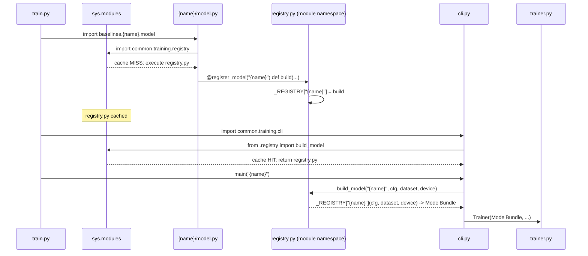

# Backbones

Each backbone model has its own training entrypoint at `baselines/{name}/train.py`.

PC, AM-SSM and AURL have no entrypoint of their own. They are plug-ins that run on top of any backbone:

- **PC** (Popularity Compensation) re-scores items at evaluation time. Its implementation lives in `popularity_compensation.py` but its entrypoint is `../scripts/pc.py`.
- **AM-SSM** replaces the BPR loss in the trainer. It is enabled by adding a `training.ssm` block to the config.
- **AURL** adds two auxiliary losses to the BPR loss. It is enabled by adding a `training.aurl` block to the config.

## Decorator-based registry pattern

Each `{name}/model.py` decorates its `build()` function with `@register_model("{name}")`, which inserts `fn` into a module-level dict `_REGISTRY`.

This is the **decorator-based registry pattern**.

Instead of enumerating every baseline, each baseline registers itself as a side effect of being imported when executing the `{name}/train.py`.

The pattern works because of two Python behaviours:

1. A module's body runs exactly once, the first time it is imported; the resulting module object is cached in `sys.modules`, and every later `import` of the same module returns that cached object without re-running its body.
2. A decorator only fires if its module is imported. If `model.py` is never imported, `@register_model("{name}")` never executes, and `_REGISTRY` never gains a `"{name}"` entry.

`model.py` must be imported before `main()` calls `build_model`, or the lookup fails with `KeyError`. This is guaranteed because `train.py` imports `model.py` at module level, so the import completes before `main()` is called. The dependency is implicit, carried through shared mutable state in the module cache rather than an explicit argument.

